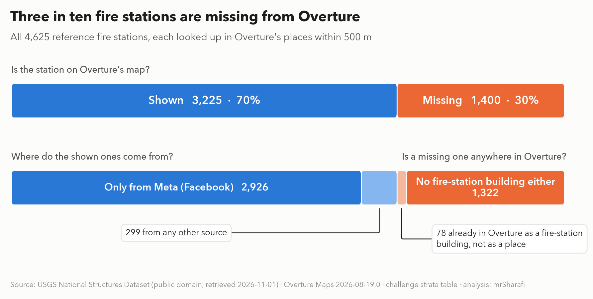
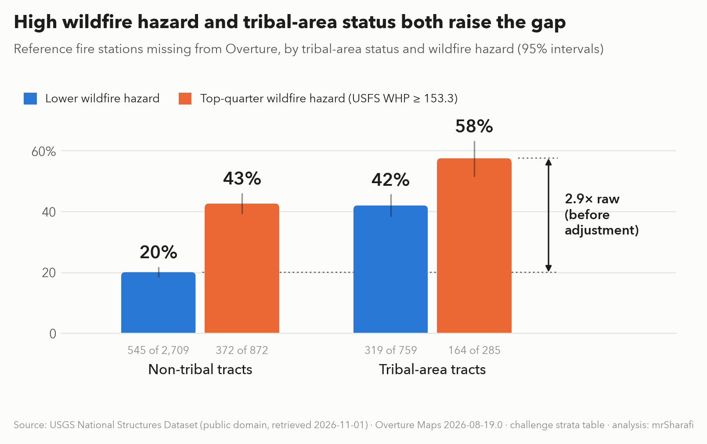
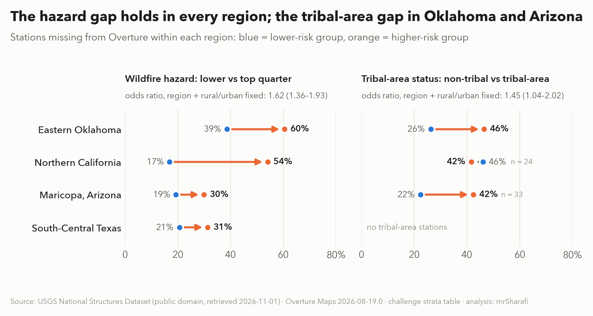
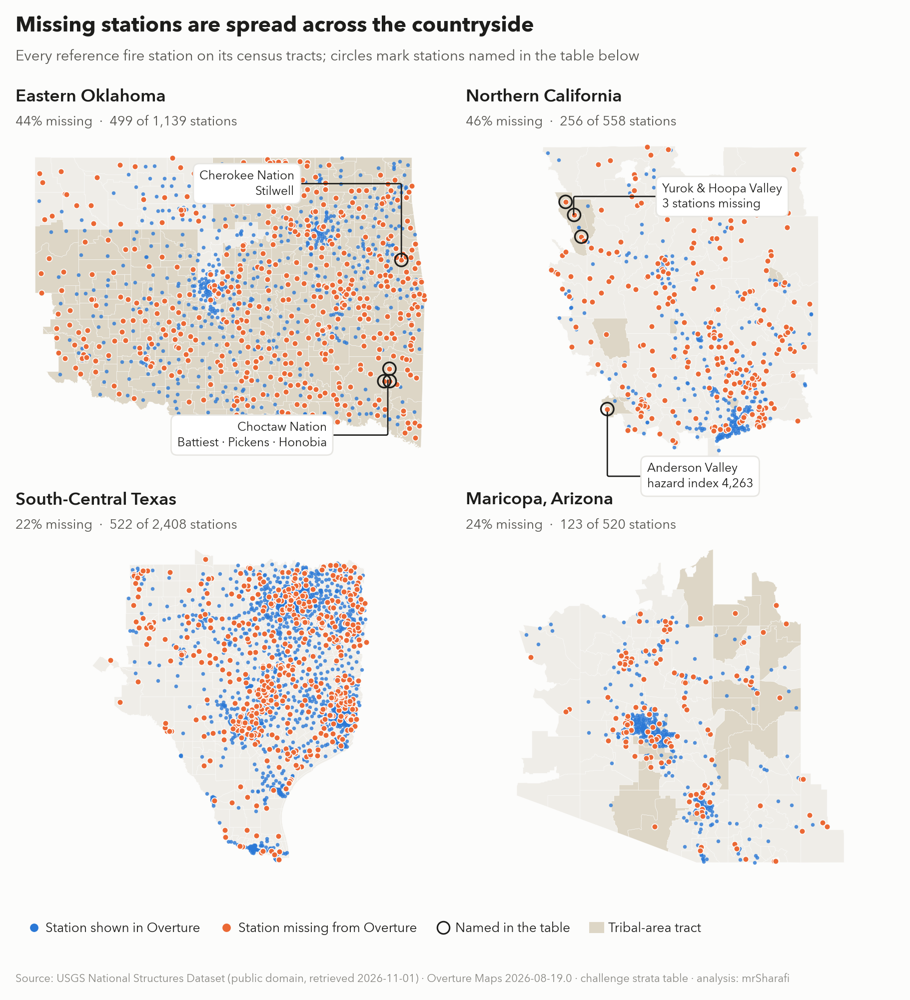
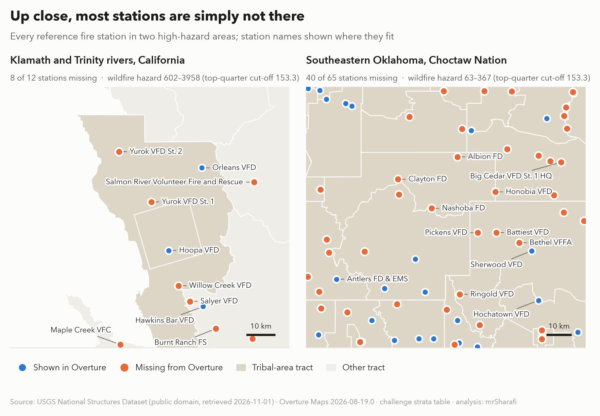
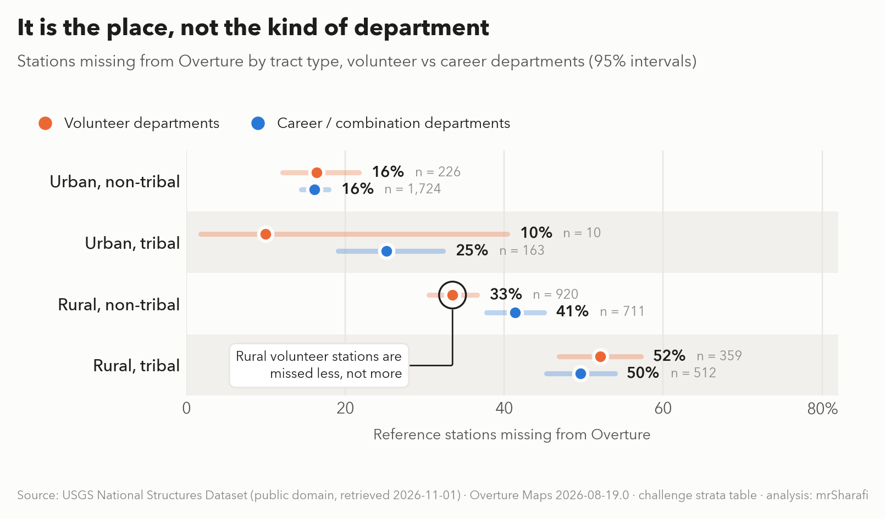

<div class="kicker">Best Bias Discovery · Zindi Bias Bounty: Mapping Equity</div>

# A third of fire stations are missing from Overture, most of all in wildfire country and Oklahoma's tribal areas

<div class="meta">Zindi user <strong>mrSharafi</strong> · 1 November 2026 · code and data: https://github.com/MohammadSharafi/bias-bounty-mapping-equity-mrSharafi</div>

<p class="lead">On the Klamath River in Humboldt County, California, the Yurok Volunteer Fire Department runs Station 1 in
Weitchpec. Its tract's wildfire hazard index is 2,233; the top-quarter cut-off in this study is 153.3. Overture's map has
no fire station within a kilometre of it. In southeastern Oklahoma, inside the Choctaw Nation, the Battiest and Pickens
volunteer departments are missing too. Across four regions, 1,400 of 4,625 public-record stations are missing, and a
typical missing station is 6.3 km from the nearest fire place Overture does show.</p>

<div class="stats">
<div class="hot"><b>30.3%</b><span>of 4,625 USGS fire stations missing from Overture (schools: 1.8%)</span></div>
<div class="hot"><b>57.5%</b><span>missing in tribal-area tracts with top-quarter wildfire hazard (245 of the 285 are in eastern Oklahoma)</span></div>
<div><b>6.3 km</b><span>median distance from a missing station to the nearest fire place Overture shows</span></div>
<div><b>84.2%</b><span>of Overture's fire places come from Meta alone (all places: 60.4%)</span></div>
</div>



*Fig. 1. Each of the 4,625 stations in the public USGS National Structures Dataset, looked up in Overture's places
(release 2026-08-19.0). Top row: is the station on the map. Bottom row: where the shown ones come from, and whether a
missing one has at least a fire-station building in Overture.*

## Who is affected

The missing stations are not slightly misplaced; they are absent from their whole neighbourhood. The median missing
station is 6.3 km from the nearest fire place Overture shows, and 58.8% are more
than 5 km from one. In rural tribal-area tracts the median is 8.9 km; in urban non-tribal
tracts it is 2.6 km. 536 missing stations sit in top-quarter-hazard tracts;
those 289 tracts have 1,065,798 residents (tract totals, not people left without a station).

The named cases are the Yurok and Hoopa Valley country on the Klamath and Trinity rivers and the Anderson Valley in
Mendocino County, the highest-hazard tracts in the study's named list; in Oklahoma, the Choctaw Nation (Battiest, Pickens,
Honobia, Finley), the Cherokee Nation (Stilwell) and Osage County (Big Bend, Drum Creek). Fire stations are where engines
stage for wildland response and where residents go when roads close. Any station finder, routing or coverage-gap analysis
built on Overture shows no station at these addresses, and every nearest-station query drawn from it skips them.

## Finding 1 — Where: wildfire hazard everywhere, tribal areas in Oklahoma

Wildfire hazard and tribal-area status each raise the share of missing stations, and the two stack. Among rural
stations, 31.3% are missing in non-tribal lower-hazard tracts, 44.7% in
non-tribal top-hazard tracts, 46.8% in tribal-area lower-hazard tracts and 59.1% in
tribal-area top-hazard tracts (n = 269).

{width=86%}

*Fig. 2. All stations, before any adjustment: 164/285 = 57.5% missing in
tribal-area top-hazard tracts against 545/2709 = 20.1% in non-tribal lower-hazard
tracts; the 2.9× arrow is that raw ratio. Whiskers are 95% Wilson intervals. Top-quarter hazard = tract USFS Wildfire Hazard
Potential of 153.3 or more, the 75th percentile across stations.*

**Is this just Oklahoma, or just rurality?** Top-quarter hazard raises the missing share in all four regions: eastern
Oklahoma 60.5% vs 38.7%, northern California 54.1% vs
16.9%, Maricopa 29.9% vs 19.3%, south-central Texas
31.3% vs 20.6%. Holding region, rural/urban and tribal-area status
fixed, a station's odds of being missing are 1.62 times higher in top-hazard tracts (95% CI 1.36–1.93).
The tribal-area effect is smaller and regional: with region, rural/urban and hazard fixed the odds ratio is
1.45 (1.04–2.02). It is clear in eastern Oklahoma (46.5% vs
26.3%; odds ratio 2.28, 1.54–3.36) and Arizona (42.4% vs
22.4%, only 33 tribal-area stations), but absent in northern California
(41.7% vs 46.1%, 24 stations). Without the rural/urban
adjustment the odds ratios are 2.29 and 1.91.

{width=92%}

*Fig. 3. Within-region shares; the odds ratios hold region, rural/urban and the other factor fixed (see Method).*

## Finding 2 — Why: fire stations, not facilities in general, and a feed with no backup

Overture does not lose public facilities in general. Under the same 500 m test, 1.8% of
12,585 USGS schools and 1.0% of 768 hospitals are missing, against
30.3% of fire stations. What sets fire stations apart is where Overture gets them:
84.2% of Overture's fire places have Meta as their only upstream source, against
78.2% of civic places and 60.4% of all places; among the stations Overture does show
it is 90.7%. Meta dependence alone does not explain the gap, since civic places are almost as
Meta-heavy and are rarely missing. What it does explain is fragility: where Meta has no fire-station record, Overture has
almost no second route to one. We cannot see Meta's own data, so this is a well-supported mechanism, not a proven cause.

Yet for **78** of
the 1,400 missing stations, Overture already holds the station: its own buildings theme has a footprint of class
`fire_station` (from OpenStreetMap) within 500 m. Linking those footprints to the places theme would restore them with
data Overture already ships (the pale orange slice in Fig. 1).

## Where the missing stations are

The missing stations (orange) spread across the countryside, while the stations Overture shows (blue) cluster in the
cities. Most of eastern Oklahoma is tribal-area land (shaded):

{.map}

*Fig. 4. Tribal-area tracts are shaded (`tribal_any` in the challenge's strata table). Circles mark stations named in the
named-stations table.*

Up close the pattern is stark. Along the Klamath and Trinity rivers, Overture shows Orleans and the two Hoopa stations,
but not Yurok Station 1, Yurok Station 2, Willow Creek, Salmon River or Salyer. In southeastern Oklahoma, inside the
Choctaw Nation, most of the stations in the frame are missing:



*Fig. 5. The frames are about 95 km (California) and 110 km (Oklahoma) across; counts in the panel headings cover every
reference station inside the frame. Frames were chosen in high-hazard areas and are more affected than their regional
averages.*

## Finding 3 — It is the place, not the kind of department

Volunteer stations are missed more overall (35.2% vs 27.9%), but that follows from where they are.
Within each tract type the two are missed at similar rates: rural tribal-area 52.1% vs
49.6%. In rural non-tribal tracts volunteer stations are missed *less*
(33.5% vs 41.4%). The data do not support a "volunteer departments
have no Facebook page" explanation (we cannot observe Facebook pages directly).

{width=88%}

*Fig. 6. Lines are 95% Wilson intervals; n is the number of reference stations in each group. Cell counts are in the appendix.*

## How strong is this?

| check | result |
|---|---|
| Matching radius | missing shares move by under 2 points at 250 m and 1 km (volunteer 37.0% / 35.2% / 33.7%; other 29.2% / 27.9% / 26.3%) |
| Mislocation | the median missing station is 6.3 km from any Overture fire place; 58.8% are more than 5 km away |
| Generic rural sparsity | same test: schools 1.8% missing (n = 12,585), hospitals 1.0% (n = 768) |
| Rurality | hazard odds ratio 1.62 (95% CI 1.36–1.93), tribal-area 1.45 (95% CI 1.04–2.02), with region and rural/urban held fixed |
| Region | hazard gap in all four regions; tribal-area gap in Oklahoma and Arizona, not northern California |
| Provenance baseline | Meta-only: fire places 84.2%, civic 78.2%, all places 60.4% |
| Public re-run | 4,625 stations from the live USGS service; all 4,625 match the earlier challenge-package copy (3 stations it listed are no longer in the service) |

**Limitations.**

- Matching is by distance and fire category, not by name, so errors run both ways: a nearby unrelated fire place can
  make a station look present, and a station filed under a non-fire name in a shared civic building can make it look missing.
- The reference can list stations that have closed or moved; we did not verify stations individually.
- Stations in one tract share its hazard value, so intervals that treat stations as independent are somewhat too narrow.

## What should change

::: {.callout}
1. **Overture: add a public second source for emergency facilities.** The USGS National Structures Dataset is public
   domain and lists every station in this study. Today 84.2% of Overture's fire places rest on Meta alone.
2. **Overture: link what it already ships (a quick win).** 78 of the 1,400 missing stations
   (5.6%) have an OpenStreetMap `fire_station` building within 500 m in Overture's own
   buildings theme. Joining those footprints to the places theme restores them with no new data.
3. **Map users: do not trust absence.** In rural and tribal-area tracts, "no station here" in Overture is often wrong.
   Station finders and coverage analyses should cross-check a public facility list first.
4. **The scorecard: add three views.** A per-facility check against a public reference, with a control category such as
   schools; a split by data provenance (`sources`); and intersections such as tribal-area × wildfire hazard.
:::

## The named stations

12 of the 187 missing volunteer stations in rural tribal-area tracts, highest hazard first
(top-quarter cut-off WHP 153.3). The four California rows lead on hazard; their tracts are flagged tribal by overlap and
illustrate the hazard effect (in northern California the tribal-area flag does not raise the missing share). None has an
Overture fire place within 1 km except Bethel (660 m).

| station (reference name) | city | region | tract GEOID | wildfire hazard (USFS WHP) | tract residents |
|---|---|---|---|---|---|
| Anderson Valley Volunteer Fire Department Station 744 | Yorkville | northern-ca | 06045011800 | 4,263 | 2,053 |
| Yurok Volunteer Fire Department Station 2 | Hoopa | northern-ca | 06023010102 | 2,233 | 2,914 |
| Yurok Volunteer Fire Department Station 1 | Weitchpec | northern-ca | 06023010102 | 2,233 | 2,914 |
| Willow Creek Volunteer Fire Department | Willow Creek | northern-ca | 06023010102 | 2,233 | 2,914 |
| Big Bend Volunteer Fire Department | Ralston | eastern-ok | 40113940003 | 384 | 4,406 |
| Drum Creek Volunteer Fire Department | Ponca City | eastern-ok | 40113940003 | 384 | 4,406 |
| Honobia Volunteer Fire Department | Honobia | eastern-ok | 40127097600 | 367 | 2,627 |
| Highway 100 West Volunteer Fire Department | Stilwell | eastern-ok | 40001376800 | 361 | 3,848 |
| Battiest Volunteer Fire Department | Battiest | eastern-ok | 40089098200 | 356 | 2,349 |
| Bethel Volunteer Fire Fighters Association | Bethel | eastern-ok | 40089098200 | 356 | 2,349 |
| Pickens Volunteer Fire Department | Pickens | eastern-ok | 40089098200 | 356 | 2,349 |
| Finley Community Volunteer Fire Department | Finley | eastern-ok | 40127097800 | 332 | 2,571 |

## How this differs from other entries

The automated scorecard reports five metrics per tract over fixed strata. This entry works per facility against an
independent public list, with control categories (schools, hospitals) showing the omission is specific to fire stations;
it splits by data provenance (Overture `sources`, which the scorecard never reads) and crosses tribal-area status with
wildfire hazard. None of the entries below reports a per-facility reference check or a control category.

| entry | what it shows | what ours adds |
|---|---|---|
| Hunter_Toledo (8 Oct), "coverage deserts are authorship deserts" | rural tracts with no Overture fire POI; POIs carry no OSM records | a station-level check against a public reference: real stations, named, that Overture misses, and how far away the nearest shown one is |
| mugeha-laura (31 Oct), hidden fire departments | fire departments that are in Overture but filed outside the fire categories | the opposite failure: stations absent from Overture altogether. We search fire names in every category, so their "hidden" departments count as shown here |
| hero76 (31 Oct), ambulances filed as fire stations | wrong records inside Overture's fire category | missing records, checked against the reference |
| vigohan (14 Oct), phantom roads | unnamed, unedited TIGER-import roads near the Texas border | a different layer (facilities) and a different failure (omission, not phantom features) |

## Method, data and reproducibility

**Method.** For each reference station we take the nearest Overture place filed as `fire_department` or
`fire_protection_service`, or carrying a fire-station name in any other category. A station is *missing* when no such
place lies within 500 m. Tract fields come from the challenge's strata table: rural = `pct_urban` < 0.5; tribal-area =
the tract overlaps a reservation or tribal statistical area (`tribal_any`), which in eastern Oklahoma covers most tracts;
hazard = `usfs_WHP_mean`, cut at 153.3, the 75th percentile across stations. *Meta-only*: the matched place lists Meta and no
other upstream dataset among its sources. Schools and hospitals use the same 500 m rule with their own categories and
names. Rates carry 95% Wilson intervals; odds ratios are Mantel–Haenszel, stratified as stated, with
Robins–Breslow–Greenland intervals.

**Data.** Fire stations, schools and hospitals: USGS National Structures Dataset (public domain), National Map service
https://carto.nationalmap.gov/arcgis/rest/services/structures/MapServer, layers 16 (Fire Stations/EMS Stations, FCode
74026), 23 (Schools) and 14 (Hospitals/Medical Centers), retrieved 2026-11-01 by `research/fetch_usgs_stations.py`; the
snapshots are committed in `data_public/external/`. The live service changes over time, so use the committed snapshot to
reproduce the exact numbers. Catalogue:
https://catalog.data.gov/dataset/usgs-national-structures-dataset-usgs-national-map-downloadable-data-collection. Overture
places and buildings (release 2026-08-19.0), tract polygons and the strata table come from the challenge package (CC BY-SA
4.0). The rules allow additional public datasets for this prize; none of our leaderboard submissions reads the USGS data
(`model/paths.py`, `check_compliance.sh`). Associated leaderboard submissions: `RzkTLsFj` and `2gyMPZPa`.

**Reproduce** (about 3 minutes on a laptop):

```
.venv/bin/python research/fetch_usgs_stations.py              # optional re-fetch
.venv/bin/python research/fetch_usgs_stations.py --layer 23 --out usgs_schools.csv
.venv/bin/python research/fetch_usgs_stations.py --layer 14 --out usgs_hospitals.csv
PYTHONPATH=. .venv/bin/python research/discovery_stations.py  # stations
python3 research/discovery_robust.py                          # robust.json
PYTHONPATH=. .venv/bin/python research/discovery_checks.py    # checks.json
.venv/bin/python research/discovery_meta_baseline.py          # meta baseline
python3 research/discovery_figures_v3.py                      # Figs. 1-6
python3 research/check_entry_numbers.py                       # NUMBERS OK
```

## Appendix — full tables

**Tribal-area status × wildfire hazard** (the cells of Fig. 2; columns: lower hazard, top-quarter hazard).

| tract type | not top-quartile wildfire hazard: missing | top-quartile wildfire hazard: missing |
|---|---|---|
| non-tribal | 545/2709 = 20.1% (18.7-21.7) | 372/872 = 42.7% (39.4-46.0) |
| tribal | 319/759 = 42.0% (38.6-45.6) | 164/285 = 57.5% (51.7-63.1) |

**Volunteer vs career by tract type** (the cells of Fig. 6).

| tract type | volunteer: missing | other: missing |
|---|---|---|
| urban, non-tribal | 37/226 = 16.4% (12.1-21.8) | 278/1724 = 16.1% (14.5-17.9) |
| urban, tribal | 1/10 = 10.0% (1.8-40.4) | 41/163 = 25.2% (19.1-32.3) |
| rural, non-tribal | 308/920 = 33.5% (30.5-36.6) | 294/711 = 41.4% (37.8-45.0) |
| rural, tribal | 187/359 = 52.1% (46.9-57.2) | 254/512 = 49.6% (45.3-53.9) |

**All stations.**

| reference stations | n | missing from Overture (no fire place within 500 m) | 95% CI |
|---|---|---|---|
| volunteer departments | 1515 | 533 (35.2%) | 32.8-37.6% |
| all other (career/combination) | 3110 | 867 (27.9%) | 26.3-29.5% |
| all | 4625 | 1400 (30.3%) | 29.0-31.6% |

**By region** (volunteer stations are missed more in every region; the tract-type table above shows that this follows
from where they sit):

| region | volunteer: missing | other: missing |
|---|---|---|
| eastern-ok | 192/384 = 50.0% (45.0-55.0) | 307/755 = 40.7% (37.2-44.2) |
| maricopa-az | 12/28 = 42.9% (26.5-60.9) | 111/492 = 22.6% (19.1-26.5) |
| northern-ca | 41/78 = 52.6% (41.6-63.3) | 215/480 = 44.8% (40.4-49.3) |
| south-central-tx | 288/1025 = 28.1% (25.4-30.9) | 234/1383 = 16.9% (15.0-19.0) |
