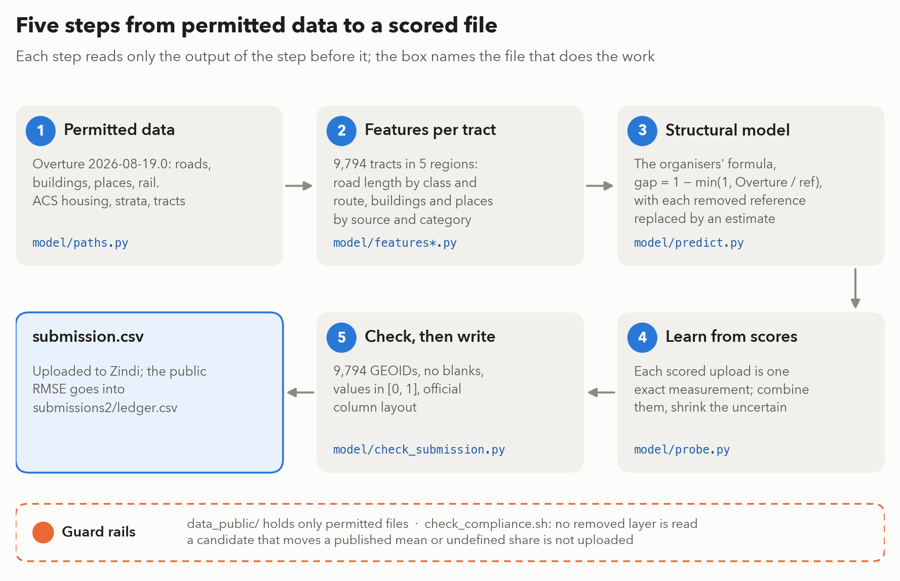
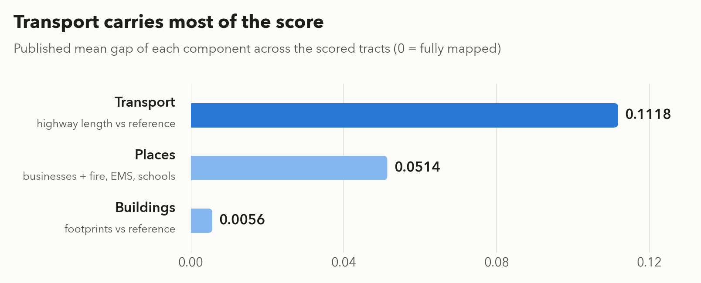
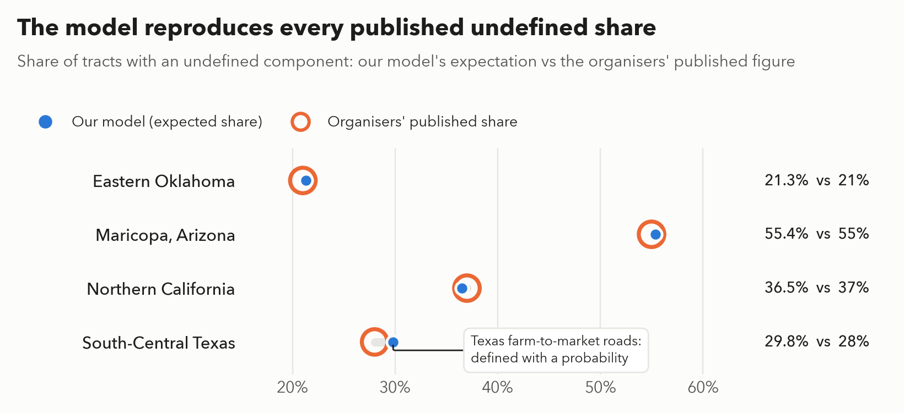
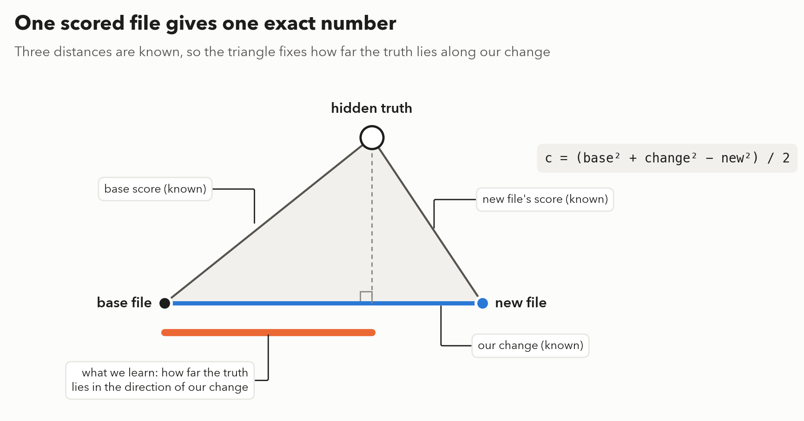
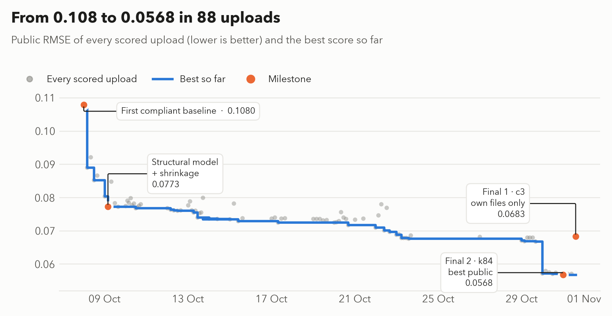

Best Documentation · Zindi Bias Bounty: Mapping Equity

# Predicting map coverage gaps without the answer key

Zindi user <strong>mrSharafi</strong> · final submissions <code>RzkTLsFj</code> (<code>c3_clean_regions_grp05</code>, public RMSE 0.068339)
and <code>2gyMPZPa</code> (<code>k84_k55_line145_rown512k3</code>, public RMSE 0.056774) · 1 November 2026

On 25 September the organisers took away the data their score is computed from. This is how we kept
predicting it anyway: keep their formula, estimate what was removed from what is still allowed, and learn the rest from
our own leaderboard scores, one exact number at a time.

<b>9,794</b>census tracts scored, in 5 regions

<b>88</b>scored uploads, every one logged

<b>0.0568</b>best public RMSE (k84), down from 0.108

<b>5 s</b>to rebuild the clean final file (c3), byte for byte

*Fig. 1. Steps 1–3 are deterministic; step 4 is the only one that reads public scores; the guard rails run before every upload.*

## In one minute

The organisers score every census tract with a *coverage gap*: how much of the real world is missing from
Overture Maps. On 25 September they removed the reference layers that the score is computed from (TIGER roads,
Microsoft buildings, HIFLD/USGS facilities, County Business Patterns). So the task became: **predict a
formula's output without the data the formula needs.**

Our solution has two layers, and this document explains both with pictures:

1. **A structural model.** We keep the organisers' formula exactly and replace each removed quantity with the
   best estimate we can build from the permitted layers. We pin every free parameter to a number the
   organisers published.
2. **Learning from our own scores.** There are no labels, but every upload returns one exact number. One
   scored file tells us exactly how far the truth lies in the direction of that file. We combine many such
   measurements and shrink the uncertain ones.

## 1. The pipeline at a glance

Fig. 1 (above) shows the whole pipeline. Each step reads only the output of the step before it. Steps 1 to 3 are deterministic and need no
leaderboard. Step 4 is the only step that uses public scores. Step 5 refuses a file that Zindi would reject.

## 2. What the score is made of

The score of a tract is the **mean of its defined components**. Each component compares Overture with a
reference: `gap = 1 − min(1, Overture / reference)`. A component is *undefined* when the reference is zero
(for example, a tract with no highway in the reference). The organisers published the mean of each
component over the scored tracts:

{width=84%}

*Fig. 2. Most of our effort went into estimating the removed highway reference; buildings are almost always fully mapped.*

## 3. Step by step

### Step 1 — Permitted data (`model/paths.py`)

Only files that are still in the organisers' bucket: Overture release 2026-08-19.0 (`buildings`, `roads`,
`roads-unfiltered`, `pois`, `rail`, `infrastructure`), ACS housing units, the strata tract tables, tract
polygons and the per-region sample submissions. `model/paths.py` lists them and refuses any other path.
The pipeline runs from `data_public/`, a folder that contains only those files, so it **cannot** read a
removed layer by accident.

### Step 2 — Features per tract (`model/features*.py`)

For each of the 9,794 tracts:

- **Roads.** Length inside the tract, measured in metres after projecting to EPSG:5070 and then clipping.
  The length is split by road class and by route network (Interstate, US, state, Texas FM/RM, county, BIA).
- **Buildings.** Footprint counts by centroid, split by source (Microsoft ML Buildings, OpenStreetMap, Esri).
- **Places.** Counts in total, per facility category (fire, EMS, the six school codes) and per source dataset.
- **Context.** Population, urban share, land area, RUCA, tribal overlap and SVI, from the strata table.

### Step 3 — Structural model (`model/predict.py`)

We keep the organisers' definitions and replace each removed reference quantity:

| component | removed reference | our estimate from permitted data |
|---|---|---|
| transport | TIGER primary and secondary roads | Overture length on numbered routes + 0.17 × un-routed highway-class length (+ 0.56 × county routes in eastern Oklahoma) |
| buildings | Microsoft footprints | Overture's Microsoft-sourced footprints + the OSM/Esri ones that hide a Microsoft footprint |
| places | County Business Patterns, HIFLD/USGS facilities | BrightQuery-sourced places; the probability that a reference fire station, school or EMS exists, given what Overture shows |

**How the free numbers were set.** The organisers published the share of tracts with an undefined
component in each region. Our transport rule has to reproduce those shares, and it does:

{width=80%}

*Fig. 3. The model value is the expected transport-undefined share (METHODOLOGY.md, table B.4).*

The second published fact is the band of the Overture-to-reference highway ratio (0.71 to 1.59). The weights
0.17 and 0.56 are the values that put every region inside that band. The full reasoning, including
boundary highways and the expected-gap formula, is in `METHODOLOGY.md`, Part B.

### Step 4 — Learning from our own scores (`model/probe.py`)

There are no labels. But each upload returns its public RMSE, which is the distance between our file and the
hidden truth. Three distances are known: the base file's score, the new file's score, and the size of the
change we made. Like a triangle with three known sides, this gives **one exact number**: how far the truth
lies in the direction of our change.

{width=84%}

*Fig. 4. With mean squared distances, c is the public-tract average of change × (truth − base).*

Many scored files give many such directions. `model/probe.py` combines them into one step towards the truth
(least squares over the measured directions). Two safety rules keep it honest:

- **Shrinkage.** A measured direction is kept only where it stands clear of the noise that a random public/private split
  would produce (a positive-part James-Stein factor per direction, set by `kappa`).
- **Published means.** Region and group means posted on the Zindi forum pull each region part of the way
  towards its measured value (`calibrate_regions`, `calibrate`). Small regions move less.

The public score improved step by step as each idea was measured:

{width=94%}

*Fig. 5. Grey: every scored upload; blue: the best so far; orange: milestones and the two final files.*

### Step 5 — Check, then write (`model/check_submission.py`)

Every file is checked before upload: the header is `GEOID,coverage_gap_score`; the GEOIDs, read as text, are
exactly the 9,794 IDs from the sample submissions (no duplicates, no extras); there are no blank cells; and
every score is a finite number in [0, 1].

## 4. The two final files

| | `c3` (RzkTLsFj) | `k84` (2gyMPZPa) |
|---|---|---|
| public RMSE | 0.068339 | 0.056774 |
| built from | the challenge package, our own scored files, numbers posted on the Zindi forum | starts from a scored file another team published (iam-dante `tr_u1_000`) and also fits on other teams' published files and scores |
| how | `research/clean_fit.py` + `probe.calibrate_regions` + `probe.calibrate(0.5)`; one command, byte-identical rebuild (section 5) | `research/bag_fit.py --own --nb 512 --kaps 3 --build 3` gives the fitted step, then a line step along `k53` (`research/LOOP_LOG.md`, 31 Oct); research code, not packaged as one command |

We chose one file of each kind on purpose. `c3` uses nothing outside our own work and the public forum, and
it is the file this documentation is built around. `k84` scores better but depends on other teams' public
files. We disclose that here so the organisers can apply the rules as they see fit.

## 5. How to reproduce

    make env                                         # Python 3.10, pinned packages (requirements.txt)
    BB_DATA=data_public python -m model.features     # step 2: per-tract features (~5 min on a laptop)
    python -m model.predict                          # step 3: structural model + one-knob variants
    ./check_compliance.sh                            # guard rail: model/ reads no removed layer
    PYTHONPATH=. python3 research/clean_fit.py --out c1_clean_fit                  # step 4
    PYTHONPATH=. python3 -c "from model import probe as pr; \
      pr.calibrate_regions('c1_clean_fit', 'c2_clean_regions'); \
      pr.calibrate('c2_clean_regions', 'c3_clean_regions_grp05', 0.5)"
    PYTHONPATH=. python3 -m model.check_submission submissions2/c3_clean_regions_grp05.csv   # step 5

Step 4 reads the scored files in `submissions2/` and their public scores in `submissions2/ledger.csv`.
On 1 November 2026 these commands rebuilt `c1`, `c2` and `c3` **byte-identical** to the uploaded files
(sha1 of `c3`: `c781cf25…`) in about 5 seconds.

## 6. Runtime, environment and performance

| item | value |
|---|---|
| machine | Apple Silicon laptop, 16 GB RAM, no GPU |
| software | Python 3.10.12, numpy 2.2.6, pandas 2.3.3, pyarrow, DuckDB 1.5.5 (`spatial`, `httpfs`), matplotlib for figures |
| features (step 2) | about 5 minutes from a local copy; Texas (4.4 M footprints) dominates |
| fit and calibration (step 4) | about 5 seconds |
| randomness | none in steps 1–3 and 5; step 4 bagging uses a fixed seed (`--seed`, default 11) |
| output | rows sorted by GEOID, so a rebuild is byte-identical |

## 7. Error handling and logging

- **Published numbers as a gate.** `model/constraints.py` scores every candidate structure against all
  published aggregates at once (undefined shares, component means, the 0.71–1.59 ratio band). Candidates
  that moved a published mean, or an undefined share by more than 3 points, were not uploaded.
- **Input whitelist.** `model/paths.py` raises an error on any path that is not a permitted file.
- **Output check.** `model/check_submission.py` exits with an error and prints the reason (wrong header,
  missing or extra GEOIDs, blank cell, value outside [0, 1]).
- **DuckDB pitfalls are fixed at the source.** `model/paths.py` sets path-style S3 URLs (the bucket name
  contains dots) and `model/features.py` projects with `always_xy := true` (otherwise lengths come back as
  `inf` or `NaN` without an error).
- **Every upload is logged.** `submissions2/ledger.csv` holds the file name, date, public RMSE and a note
  for all 88 scored uploads; `research/LOOP_LOG.md` records each decision and its evidence.

## 8. Maintenance and monitoring

- **Pinned inputs.** Overture release 2026-08-19.0 in the organisers' bucket. If the organisers re-cut the
  data, the published-number checks fail loudly.
- **Schema watch.** The places features need `categories.primary`, which Overture deprecates in later
  releases. A newer release needs that column mapped before step 2 is re-run.
- **New regions.** Add the region to `REGIONS` in `model/paths.py`; the feature code is region-agnostic.
- **Re-fitting.** After new uploads, append their scores to `ledger.csv` and re-run step 4. Keep the uploaded
  bytes unchanged: step 4 assumes each file on disk is exactly the file that was scored.

## 9. Weightings

We use the organisers' equal weighting as specified: the arithmetic mean of the defined components, and
inside places the equal mean of the two halves and of the defined facility types. No alternative weighting
was applied.

## 10. What we learned (limits)

- **Published scores are not always exact.** Several teams published files with their scores. When we
  checked them against our own exactly-known files, some disagreed by 1–5% of a step. Small errors like this
  can make a combined fit promise far more than it delivers: our `k84` delivered about 13% of its predicted
  gain from those files. We now model this error (`--cerr` in `research/bag_fit.py`); with it, no further
  safe gain was found.
- **The public split is 30% of tracts.** A gain on the public board can partly be noise. The shrinkage
  factor `kappa` and the private-score simulation in `research/bag_fit.py` exist to guard against this.
- **The structural model alone is weak at tract level.** With simple shrinkage it reached 0.0773; most of
  the later gain comes from step 4, which needs scored uploads.

Full technical detail: `METHODOLOGY.md` (Part B) and the code. Every number above comes from a file in this
repository.
